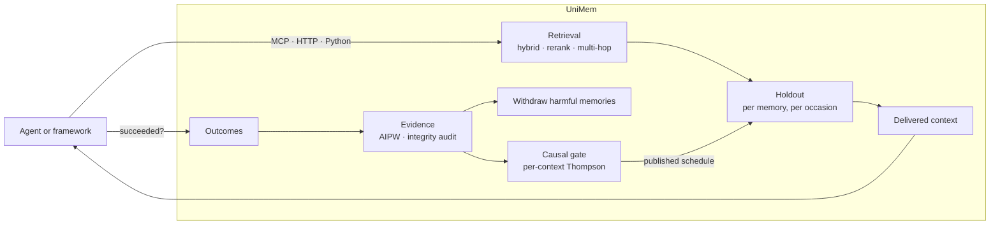

# UniMem

**A referee for how agents and robots change themselves.**

Agents with memory repeat fewer mistakes, until a memory goes stale. Then the agent acts confidently on something that is no longer true, and nothing tells you which memory caused it. UniMem is the independent referee for how agents and robots change themselves: it measures memories, skills, writers and optimizer edits through randomized evidence; governs promotion and rollback; and carries verifiable evidence across trust boundaries. Its memory trials withhold eligible memories from a small random share of tasks, compare outcomes, withdraw harmful memories, and learn where each memory helps. The Python package and executable remain `unimem`.

- **Causal, not correlational.** A randomized holdout per memory and per task gives a real cause-and-effect estimate for each memory, with integrity checks that catch a broken experiment before you quote it.
- **Governed.** Lessons need review receipts, facts carry valid time and record time, every write is scoped to a tenant, and anything an agent cannot see can never leak into its answers.
- **Local-first.** The core is pure Python with one dependency (PyYAML). It runs offline, needs no LLM, and starts in seconds.
- **Agent-native.** It ships an MCP server with 60+ tools, an HTTP gateway, framework middleware, and one-command installs for coding agents.

```
pip install -e .        # Python 3.10+
```

---

## Contents

- [Quickstart](#quickstart)
- [Prove that memory helps](#prove-that-memory-helps)
- [Learn where each memory helps: the causal gate](#learn-where-each-memory-helps-the-causal-gate)
- [What's inside](#whats-inside)
- [Connect your agent](#connect-your-agent)
- [The Hub: multi-tenant server](#the-hub-multi-tenant-server)
- [Architecture](#architecture)
- [Project status](#project-status)
- [Development](#development)
- [License](#license)

---

## Quickstart

```bash
python -m pip install -e .

unimem init --dest ./mem
unimem fact add "The launch checklist is stored in the blue folder." --dest ./mem
unimem recall "Where is the launch checklist stored?" --dest ./mem
```

To run a local gateway and console against a project (the default port is 8787):

```bash
unimem up --dest /path/to/agent-project
```

To run an offline end-to-end check that needs no model and no server:

```bash
python scripts/first_recall_smoke.py
```

## Prove that memory helps

Every memory system claims to make agents better. UniMem measures whether it does, one memory at a time, the way a clinical trial would:

1. On each task (an *occasion*), every eligible memory is either shown or withheld by a deterministic hash of the memory, the occasion and a salt. That makes the split random, reproducible, and stable when a task is retried.
2. You report whether the task succeeded.
3. The difference between the shown and withheld arms is that memory's causal effect. The estimate comes with a confidence sequence that stays valid however often you look at it.

Start an experiment, wrap your existing retrieval, and report outcomes:

```bash
unimem experiment --configure --rate 0.5 --dest ./mem
```

```python
from unimem.measure import CausalMemory

memories = [
    {"id": "retry-429", "text": "On HTTP 429, back off exponentially and retry."},
    {"id": "verify-owner", "text": "Verify the account owner before any password reset."},
]
memory = CausalMemory(lambda task, **_: memories, root="./mem",
                      key=lambda m: m["id"], text=lambda m: m["text"])

shown = memory.recall("customer cannot log in", occasion_id="ticket-1042", context="support")
# ... run your agent with `shown` in its context ...
memory.record_outcome("ticket-1042", succeeded=True)
```

Then read the evidence:

```bash
unimem experiment --dest ./mem
```

```
| Memory         | Verdict      | Injected | Effect | Occasions | Counted |
|----------------|--------------|---------:|-------:|----------:|---------|
| `verify-owner` | HELPS        |      208 | +26.5% |       +55 | yes     |
| `retry-429`    | UNDERPOWERED |      189 |  -3.5% |        -7 | no      |
```

<sub>Output from a synthetic 400-occasion run. The real report also includes an integrity audit, power projections and the exact text revision each effect describes.</sub>

The integrity audit runs before any effect is shown. It checks for differential attrition between the arms, arm-balance (sample-ratio) mismatch, a reshuffled randomization, scorer drift, a memory edited mid-run, and censoring. If the run is compromised, UniMem says so instead of printing a confident wrong number.

To act on the evidence automatically:

```bash
unimem retrieval --on-harm withdraw --dest ./mem   # stop delivering memories proven to hurt
```

The other measurement tools:

- **Adaptive allocation.** Uncertain memories are explored at a 50% holdout; proven ones drop to a 5% monitoring rate. Rates are set by hash-chained schedules, and effects are estimated by augmented inverse-propensity weighting (AIPW) with time-uniform confidence sequences.
- **Interference detection.** The holdouts are independent per memory, so you get a factorial design for free. UniMem flags pairs of memories that hurt each other.
- **Value ledger.** Effects are converted into your own units (tickets resolved, dollars saved) in a SHA-256 hash-chained ledger. It can be HMAC-signed for reporting.
- **Subgroup effects** by agent type or covariates, **survival analysis** for outcomes that arrive late, and **preregistration and proof packages** that a third party can verify.

## Learn where each memory helps: the causal gate

An average can hide two opposite effects. A lesson about the test runner helps the coding agent and distracts the support agent. Its average effect is near zero, so a global verdict either keeps it everywhere or throws it away everywhere. The causal gate learns where each memory helps and makes that the injection policy:

- **Per-context effects.** Each occasion can carry a short `context` label, such as a task family or agent type. Effects are estimated per (memory, context) with self-normalized inverse-propensity weighting, so the estimates stay valid under any published rates.
- **Hierarchical shrinkage.** Estimates are pooled by empirical Bayes along *source → memory → context*, so sparse contexts borrow strength without being overwritten.
- **Causal source reputation.** A new memory from a source whose memories have measurably hurt starts from a pessimistic prior. This blunts slow memory-poisoning and bad bulk imports.
- **Thompson allocation.** Each memory is injected with the posterior probability that it helps in that context, clipped so both arms keep learning. The rates are published as hash-chained allocation schedules, so every contextual decision is audited exactly like the rest of the experiment.
- **Drift detection.** UniMem flags a memory whose effect changed over time, for example after a tool upgrade or a codebase migration. With strong evidence of drift, the gate relearns that memory from the occasions after the change.
- **An honest off-policy check.** The gate is fitted on earlier occasions and scored on later ones by importance sampling over each occasion's full assignment, against what was actually delivered.

```bash
unimem allocate enable --mode thompson --dest ./mem
unimem allocate plan --if-due --dest ./mem      # run on a schedule, e.g. hourly
unimem allocate gate --dest ./mem
```

```
[unimem] causal gate over 800 resolved assignments (between-lesson sd 20.7%, between-context sd 2.0%)
  memories (posterior effect, P(helps), proposed withholding):
    retry-429: -2.8% +/- 4.8%, P(helps) 28%, withhold 72% [189 shown / 211 withheld, source local]
    verify-owner: +25.8% +/- 4.6%, P(helps) 100%, withhold 5% [208 shown / 192 withheld, source local]
  drift: 0 of 2 memories changed effect
  off-policy check (fit on 200 occasions, scored on 200 later ones): gate 81.0% vs delivered 64.5%,
  lift +16.5% [+10.6%, +22.3%], ESS 110: IMPROVES
```

<sub>The same synthetic run as above.</sub>

The gate's posteriors are allocation weights, not proofs. Release and billing decisions keep using the experiment and its integrity audit. The same report is available to agents as the `causal_gate_report` MCP tool.

## What's inside

### Memory model

| Kind | What it is |
|---|---|
| **Lessons** | Reusable guidance distilled from agent traces. A lesson is activated only through governed approval, with review receipts bound to its exact content, and can be revoked durably. |
| **Atomic facts** | Propositions with valid time and record time, so you can query what was true then and what the store believed then (`as_of` / `known_at`). Contradictions are detected at write time; near-duplicates are consolidated. |
| **Knowledge graph** | Typed nodes and edges that record when they were valid, entity resolution, communities, and a code-structure graph for Python and TypeScript. |
| **Conversations** | Per-space conversation memory with summaries, profiles and time-aware recall. |
| **Memory blocks** | Character-limited core-memory blocks with revisions and an audit log, in the style of Letta. |
| **Procedural memory** | Recorded workflows that can be replayed. |
| **Knowledge pages and sagas** | Curated, versioned pages with dry-run diffs, and ordered narratives of incidents and migrations. |
| **Forgetting** | TTLs, evidence decay, invalidation, and erasure of a subject's local history. |

### Retrieval

- Hybrid lexical (BM25, Unicode and CJK-aware) and dense retrieval, with local or hosted embedders.
- Rerankers: local cross-encoders (`bge-reranker-v2-m3`, `mxbai-rerank`), hosted rerankers (Cohere, Voyage, Jina), or an LLM listwise reranker. If a reranker fails, the original ranking is kept.
- Multi-channel recall across lessons, facts, graph and conversations, fused under one token budget.
- Named retrievers: `hybrid`, `decomposition`, `graph-completion`, `nl-query`, `planned`, `multi-round`, `multi-hop`, `ppr`, `expanded`, `hyde`.
- Multi-hop reasoning: a Personalized PageRank walk over the fact–entity graph (HippoRAG), bridge-entity chains with explicit evidence paths (IRCoT), and compositional question decomposition.
- Semantic triplet search over the knowledge graph, plus query expansion with pseudo-relevance feedback (RM3) and hypothetical answers (HyDE).
- Every retriever applies the same scope, time, authority and evidence checks, and a fact the caller cannot see is never used even as an intermediate hop.

### Governance and security

- Tenant scopes, write-time origin binding, and visibility rules on every record.
- Review receipts for lesson admission and HMAC-authenticated curated records, designed against memory-poisoning attacks such as AgentPoison and MemoryGraft.
- Screening for secrets, PII and prompt injection (40+ patterns, Luhn-checked card numbers, redaction).
- A SELECT-only guard on model-written SQL, an offline/air-gapped mode, and pluggable secret providers.
- On the Hub: OIDC SSO, SCIM 2.0 provisioning, role-based access control, audit export, rate limiting, retention policies, subject erasure, and envelope encryption for sensitive fields with customer-held KMS keys.

### Storage

JSONL and Markdown are the canonical stores, with SQLite (WAL with FTS5) for facts. Optional backends are PostgreSQL with pgvector, LanceDB, Neo4j and FalkorDB; the optional graph databases are mirrors and the local graph stays authoritative.

## Connect your agent

**MCP.** Run the server over stdio, SSE or streamable HTTP:

```bash
unimem serve --transport stdio --dest ./mem
```

**Coding agents.** One command writes the configuration and hooks:

```bash
unimem install --target claude-code     # also: cursor, windsurf, codex, copilot, gemini, devin, opencode, generic-mcp
```

**Frameworks.**
- Native middleware: LangGraph, OpenAI Agents SDK, Pydantic AI, Google ADK and Microsoft Agent Framework.
- Tool factories: LangChain, CrewAI, LlamaIndex, AutoGen/AG2 and Strands.
- Completion wrappers: OpenAI, Anthropic and LiteLLM.

**HTTP.** The local gateway exposes `POST /v1/recall` and `POST /v1/outcome`, so any language can run the causal loop. Recall takes your candidate memories, an `occasion_id` and an optional `context`, and returns which memories to deliver, which to withhold and which were withdrawn. The full contract is in `openapi/gateway.json`.

**Interop.** Adapters for Mem0, Letta, Zep, the Claude memory store and AgentCore, plus a portable import format.

**SDKs.** TypeScript, Go, Rust and Java/Kotlin clients for the Hub, generated from its OpenAPI contract.

## The Hub: multi-tenant server

`hub/` is the multi-tenant server, built on PostgreSQL with Alembic migrations. It provides:

- MCP over streamable HTTP (34 scope-checked tools), a REST API and an OpenAPI contract.
- A customer console and an operator console.
- Stripe billing, including metered value-based billing.
- OTLP trace ingest, HMAC-signed webhooks with SSRF protection, alert rules, and collaboration features.
- The enterprise identity stack listed under [Governance and security](#governance-and-security).

Deployment assets: a pinned Docker image, `docker-compose.yml` (database, migrations, Hub, gateway and MCP), a Helm chart, Kubernetes manifests, and Terraform for AWS and GCP.

```bash
docker compose up    # set POSTGRES_PASSWORD and HUB_CONSOLE_SECRET for anything beyond a local trial
```

## Architecture



## Roadmaps

The first roadmap (F1–F22) adds authenticated lineage and transparency,
sequential release evidence, harm-budget admission, incident freezes, protected
safety memory, utility retention, context economics, scoped recovery/spatial
memory, valuation, targeting and optional robot/vendor integrations. The second
roadmap (G1–G30) extends the same governance to skills, writers, optimizer edits,
human help, team memory and robot fleets, and makes evidence portable across
trust boundaries.

Start with the [feature status and workflow links](#project-status),
[guarantees and assumptions](docs/guarantees.md), and
[physical-AI quickstart](docs/physical-ai.md). Production model training, secured
seller sandboxes and vendor authentication are pluggable deployment interfaces;
the CPU trainer, mock robot loop and metadata ingest do not claim to replace them.

The `frontier` CLI accepts a bounded JSON request and `--dest STORE`. Run
`unimem frontier --help` for the operation list. Dedicated `lineage`, `log`,
`incident`, `promote`, `safety`, `experiment`, `allocate`, `dream`, `retrieval` and
`defense` workflows remain available. Existing stores retain their canonical
legacy hashes and defaults.

## Project status

UniMem is pre-1.0 software under active development.

| Area | Status |
|---|---|
| G6 Delegated capabilities | Pinned holders, monotone HMAC/Ed25519 chains, request proofs, scoped retrieval, recipient handoffs and revocation quarantine; [workflow and limits](docs/capabilities.md). |
| G7 Team isolation | Scoped point-read snapshots, commit-time stale-generation guards, fenced work leases and reviewable semantic merges; [guarantees and limits](docs/team-isolation.md). |
| G29 Pooled evidence | Signed sufficient-statistics contributions, ownership-group random effects, modified Hartung–Knapp intervals, e-values and reference Gaussian privacy accounting; [workflow and limits](docs/pooled-evidence.md). |
| G1 Causal Skill Foundry | Authenticated trajectory induction, verifier screens, nested catalog trials, canonical promotion, signed Agent Skills evidence and decay retirement; [workflow and assumptions](docs/skill-foundry.md). |
| G3 Optimizer proposals | Typed edit and bullet trials, negative feedback, canonical promotion and estimated segment frontiers; [formats and guarantees](docs/optimizer-intake.md). |
| G4 Transfer and forgetting sentinel | Prospective cross-segment quarantine, canonical factorial canaries and update non-regression gates; [assumptions and use](docs/sentinel.md). |
| G5 Personalization audit | Separate outcome, accuracy and agreement trials, domain scope and factual evidence rules; [audit and benchmark adapters](docs/personalization-audit.md). |
| G2 Governed RL export | Complete authenticated cohorts, matched-arm preferences, DR advantage labels, replay priorities, sampled KL checks and erasure-aware streaming JSONL; [schema and limits](docs/rl-export.md). |
| G9 Writer contribution trials | Parent writer/role masks, unbiased inner eligibility, estimated reliability priors and MAST incident tags; [integration and assumptions](docs/writer-holdouts.md). |
| G8 Contagion and source diversity | Scoped read/write dependency radius, incident freeze, root concentration and admitted re-retrieval; [graph limits and integration](docs/contagion.md). |
| G10 Memory telemetry | Opt-in standard GenAI memory spans, admitted causal metadata and canonical outcome slices; [configuration and privacy](docs/otel.md). |
| G11 Effect proofs | Committed trial rows, transparent audited recomputation and optional zkVM adapter; [proof formats and limits](docs/effect-proofs.md). |
| G12 Attested key release | Fresh tenant-bound worker measurements gate encrypted key release; hardware appraisal depends on configured verifiers; [deployment boundary](docs/attested-key-release.md). |
| G20 Change streams and byte verification | Admission-filtered SSE/MCP diffs, governed Kafka forwarding, downstream deletion ACKs and conditional local byte receipts; [scope and examples](docs/change-streams.md). |
| G21 Governed payload tiers | Residency checks, verified hot/cold migration, lifecycle pre-warm, native ACL filtering and measured embedding cutover; [deployment boundary](docs/tiering.md). |
| G13 Privacy-preserving recall | Two-server XOR-PIR reference with per-clearance blocks and local reranking; [limits](docs/oblivious-recall.md). |
| G14 Verified memory policy | Bounded exhaustive no-widening proofs, review-gated activation and optional Cedar/ReBAC adapters; [finite-domain limits](docs/memory-policy.md). |
| G15 Signed memory passports | Content-addressed, signed exports, review-only imports and selectively disclosed memory credentials; [profile and boundaries](docs/memory-passport.md). |
| G16 Purpose-bound consent | Purpose-filtered retrieval, expiry-aware retention and consent explanations; [workflow and limits](docs/purpose-consent.md). |
| G17 Household scopes | Multi-party consent, ephemeral bystanders and no-memory rooms; [identity assumptions](docs/household-memory.md). |
| G18 Regulated-subject policy | Write-time modality and context rules with reviewable decisions; aligned policy profiles, not compliance claims; [scope](docs/subject-write-policy.md). |
| G19 Governed KV capsules | Tenant/model-bound local capsule references with source re-admission and configured-tier eviction; [adapter boundary](docs/kv-capsules.md). |
| G22 Human-help ledger | Governed interventions, correction-quality estimates and low-risk ask-policy trials; [assumptions](docs/human-help.md). |
| G23 World-model trust | Sim-gated replay with action-following checks, real-outcome calibration and veto-only low-trust policy; [assumptions](docs/world-model-trust.md). |
| G24 Robot signatures | Phase-aware robust force/proprioception profiles with anomaly and firmware-boundary drift records; [workflow](docs/robot-signatures.md). |
| G25 Robot working memory | Bounded local keyframe retrieval, protected safety entries and audited consolidation; [latency and API](docs/robot-working-memory.md). |
| G26 Collective site memory | Bitemporal VDA/Open-RMF adapter ingress and signed conflict-preserving fleet mesh; [adapter limits](docs/site-memory.md). |
| G27 Living safety cases | Digest-bound claim/evidence graph, staleness tracking, reproducible scenario mining and coverage view; [limits](docs/safety-case.md). |
| G28 Memory-to-action shield | Bounded STL monitor blocks unproven or violating memory-derived actions; [safety boundary](docs/robot-shield.md). |
| F11 Authenticated lineage | Signed derivations, origin quorum, minimum integrity and taint cascades; [workflow](docs/lineage.md). |
| F12 Transparency log | Signed Merkle heads, inclusion/consistency proofs, tenant-isolated Hub history; [workflow](docs/transparency-log.md). |
| F3 Sequential evidence | Predictable e-processes, shared-task e-BH for positive (HELPS) claims with harm withdrawal unweakened, nonoverlapping evidence snapshots; [workflow](docs/e-processes.md). |
| F1 Harm-budget admission | Opt-in conservative CRC/LTT gates calibrated once from ungated randomized evidence, and trajectory escalation; [workflow](docs/conformal-gate.md). |
| F15 Incident evidence | Freeze, legal hold, two-clock replay and signed evidence packs; Hub routes; [workflow](docs/incident.md). |
| F2 Change control | Preregistered canonical trials, frozen support, anytime certificates (including for the Thompson gate configuration) and rollback; [workflow](docs/promotion.md). |
| F18 Safety evidence | Reviewed protected hazards, durable recorder and intervention SPI; [workflow](docs/safety.md). |
| F8 Causal lifecycle | Reviewed rewrites randomized against their originals in retrieval, losing-rewrite rollback and learned utility budgets; [workflow](docs/causal-dreaming.md). |
| F9 Context economics | Opt-in value knapsack and deterministic proven-memory cache prefixes; [workflow](docs/context-packing.md). |
| F13 Subject-key erasure | Independent encrypted envelopes, key destruction, local cascade and conditional certificates; [workflow](docs/certified-erasure.md). |
| F14 Pre-action defenses | Quoted low-integrity data, scoped derivation, sensor checks, canaries and shadow red teams; [workflow](docs/memory-defenses.md). |
| F5 Outcome engine | Held-out surrogate agreement, active-gold residual correction and separate sim/real discrepancies; [workflow](docs/outcomes.md). |
| F16 Recovery registry | Calibrated signatures, exact fleet context, randomized lift ranking and withdrawal; [workflow](docs/recovery.md). |
| F4 Fleet interference | Cluster design, lineage write diversion, switchback burn-in and HT monitoring; [workflow](docs/interference.md). |
| F19 Valuation | Factorial value certificates, capped warranty ledger and underwriting/training metadata exports; [workflow](docs/valuation.md). |
| F17 Spatial objects | Bounded bitemporal deltas, corrections, historical beliefs and three planner MCP tools; [workflow](docs/spatial.md). |
| F6 Targeting | Disjoint DR learning, conservative RATE admission, positive-class transfer and exploration; [workflow](docs/uplift.md). |
| F7 Attribution | Budgeted randomized replay masks, sparse culprit diagnostics and restore audits; [workflow](docs/attribution.md). |
| F20 Clean room | Sealed runner interface, attested escrow, stake-weighted duplicate-cluster royalties and Laplace budget accounting; [workflow](docs/cleanroom.md). |
| F10 Compilation | Open-weight trainer contract, CPU governance reference, source rollback and artifact-bound F2 trials; [workflow](docs/compile-memory.md). |
| F21 Foreign stores | Pinned SDK/HTTP adapters, canonical measurement, lineage and redacted errors; [workflow](docs/vendor-evidence.md). |
| F22 Physical-AI bridge | Lazy ROS node, MCAP/LeRobot metadata ingest, witnessed edge cache and durable outcomes; [workflow](docs/physical-ai.md). |
| G30 Vertical packs | Eight offline-installable configuration bundles with seeded buyer reports; [catalog](docs/vertical-packs.md). |
| Local store, retrieval, MCP server, gateway, holdout experiment | Stable; covered by about 8,000 tests in CI on Python 3.10 and 3.12 |
| Hub server | Feature-complete; tested against real PostgreSQL in CI |
| Causal gate | New. Runs on the local store and the gateway; the Hub does not yet record per-assignment rates or contexts |
| TypeScript SDK | 0.1 |
| Go, Rust and JVM SDKs, JetBrains plugin | Thin clients |
| Federation noise, exploration-policy estimates, replay assurance | Experimental, and labelled as such in their output |

Benchmark harnesses for LoCoMo, LongMemEval and BEAM are included, but the datasets are not; bring your own copy. LoCoMo is licensed CC BY-NC 4.0, so never bundle it into a commercial distribution.

## Development

```bash
python -m pip install -e ".[dev]"
make lint        # ruff
make test        # tests and e2e_tests
make coverage    # with the 80% gate
```

To check the Hub and generated API contracts:

```bash
python scripts/dev.py test --hub -q  # requires HUB_TEST_DATABASE_URL: disposable PostgreSQL 16
python scripts/export_openapi.py --check
python scripts/export_hub_openapi.py --check
```

Run the focused governance boundary regressions with
`python -m pytest tests/test_governance_audit_regressions.py -q`. They cover
delegated administrative authority, immutable trial registration, design-bound
evidence, journal rotation limits, forked writer locks, cache isolation, extreme
propensities, Merkle proofs and erasure preflight. Framework memory turns allow
one second for bounded retrieval, including cold-store initialization; native
editor hooks retain their 50 ms deadline.

CI also runs strict type checks on the core modules, bandit, pip-audit, CodeQL,
a latency gate, the SDK builds, Docker and Compose smoke tests, and an architecture
audit. The exact gates are defined in [CI](.github/workflows/ci.yml),
[security checks](.github/workflows/security.yml), and the
[architecture audit](.github/workflows/graphify.yml). Use the [Graphify exploration guide](docs/architecture-exploration.md)
for local dependency queries and impact analysis. See the branch's
[Actions runs](https://github.com/varma61923/unimem-v2/actions) for current
results. Optional integrations use mocks or local fixtures; CI does not exercise
live vendor requests, payments, enclaves or robot actuation.

## License

AGPL-3.0-only. See [LICENSE](LICENSE).

Some components are adapted from permissively licensed projects (Apache-2.0 and MIT). Their notices are in [THIRD_PARTY_NOTICES.md](THIRD_PARTY_NOTICES.md).

### Research this builds on

- Randomized holdouts and anytime-valid inference: Waudby-Smith, Arbour, Sinha, Kennedy & Ramdas (2024) on time-uniform confidence sequences for AIPW, and Benjamini & Hochberg (1995).
- The causal gate: Thompson (1933) for probability matching, and DerSimonian & Laird (1986) for between-unit variance in empirical-Bayes shrinkage.
- Retrieval: HippoRAG (Gutiérrez et al., 2024), IRCoT (Trivedi et al., 2023), RM3 (Lavrenko & Croft, 2001), and HyDE (Gao et al., 2023).
- Memory poisoning: AgentPoison (Chen et al., 2024) and MemoryGraft (2025).

Finite read, write, recall and export permissions support exhaustive change checks and reviewed activation. See [memory policy](docs/memory-policy.md) for the bounded guarantee, native Cedar adapter and optional relationship prefilter.

[Owned memory passports](docs/memory-passport.md) preserve signed source snapshots through review-only imports. Holder-bound VC 2.0/SD-JWT credentials disclose selected fact fields with fresh nonce and revocation checks.

[Purpose-bound consent](docs/purpose-consent.md) restricts retrieval by verified
agent purpose, explains direct and inferred personal memories, and expires
consent through governed erasure.

[Regulated-subject write policies](docs/subject-write-policy.md) hold unknown
modalities for review, quarantine prohibited biometric emotion inferences, and
schedule child-data retention before canonical persistence.

[Human-help governance](docs/human-help.md) links correction quality to canonical
outcomes, holds unreviewed data before RL exports, and measures low-risk asking
under a shared fleet-time budget.

[Committed effect proofs](docs/effect-proofs.md) bind complete prospective
cohorts to verifier challenges and audit effect arithmetic, with optional real
RISC Zero receipt verification and private proving.

[Attested tenant key release](docs/attested-key-release.md) checks logged CPU/GPU
builds, fresh quote bindings and shared replay state before encrypting tenant
keys to approved workers.

[Household memory scopes](docs/household-memory.md) require consent for every
recognized person, keep unknown and bystander scenes ephemeral, and enforce
no-memory room rules before spatial persistence.

[Governed KV capsules](docs/kv-capsules.md) bind opaque model KV to a tenant,
source memory and model fingerprint, then evict each registered tier when the
memory is withdrawn or erased.

[World-model trust](docs/world-model-trust.md) checks action sensitivity and
tracks task-specific agreement with an anytime interval; simulation can veto or
hold a memory for real trials, never release it by itself.

[Proprioceptive signatures](docs/robot-signatures.md) compare force, tactile,
joint-current and temperature samples against phase- and payload-conditioned
robust bands, and link anomalies to their episode and recovery record.

[In-loop working memory](docs/robot-working-memory.md) offers a local keyframe
cache with a 5 ms default retrieval target, protected safety entries, and
audited predictive-keyframe consolidation.

[Collective site memory](docs/site-memory.md) validates a VDA 5050 3.0 subset,
merges vendor-neutral robot layers, estimates review-only zone rules and syncs
signed operations while preserving semantic conflicts and safety memories.
