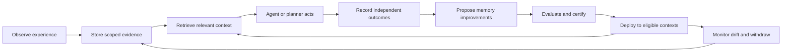

# UniMem platform direction

Status: product and engineering proposal, 2026-11-08. This document describes
intended direction and release gates; it does not change the current runtime or
claim that proposed capabilities are shipped. The initial customer assumption is
software-agent teams, subject to founder/customer validation. Enterprise LLM
applications and robots remain first-class architectural requirements.

## Product thesis

**UniMem is the persistent memory and learning infrastructure for intelligent
machines: experience becomes reusable knowledge, and deployment evidence decides
where that knowledge should be used.**

An agent should retain useful experience when its session ends, its model changes,
or its execution moves between a laptop, cloud service, and robot. A team should
be able to establish which memories improve outcomes, restrict their use, correct
them, and withdraw their derivatives. Each deployment owns its knowledge and its
sharing policy.

The product promise is a repeatable loop:

Self-learning initially means improving retained knowledge, retrieval policy,
and validated procedures. Changes to model weights are a separate governed
extension requiring a real trainer, independent evaluation, and model-specific
rollback. The existing CPU compilation reference is not a production trainer.

## Existing foundation and concrete gaps

The source links below identify implementation evidence; presence of a module
alone does not establish production fitness for every workload.

| Capability | Existing foundation | Required platform work |
| --- | --- | --- |
| Portable memory | [Versioned records](../unimem/memory_record.py), [local/HTTP client](../unimem/client.py), HTTP/MCP and language SDKs | Publish a capability/version matrix and verify equivalent semantics across supported transports. Preserve existing record types and wire compatibility. |
| Measured learning | [Graded rewards](../unimem/rewards.py), causal gate, effect fields, [promotion](../unimem/promotion.py) | Establish one end-to-end delivery/outcome contract across local, hosted, and robot integrations. Bind every estimate to actual delivery, exact revisions, and a frozen utility/scorer. |
| Hosted operation | Multi-tenant PostgreSQL Hub, authentication, retention, deployment and recovery controls | Close contextual/graded learning parity, then validate sustained load, recovery, upgrade, and regional operation on the actual managed deployment. |
| Hosted measurement gap | [Hub tool definitions](../hub/server.py) expose `record_occasion_outcome(occasion_id, succeeded)` and a holdout assignment tool without contextual/adaptive-rate arguments | Design an additive versioned extension. Demonstrate graded outcomes, contextual assignment metadata, retry behavior, and export/replay parity before advertising full hosted learning equivalence. |
| Physical AI | [Robot bridge](../unimem/robotics/bridge.py), ROS interfaces, durable outcomes, [working memory](robot-working-memory.md) | Validate named robot/firmware/sensor profiles with hardware partners. Extend outcome parity and prove reconnect, calibration, privacy, and timing behavior on their devices. |
| Trust and portability | Provenance, scopes, consent, legal holds, signed exports, policy checks and derivative withdrawal | Verify the complete behavior through each supported adapter, including downstream deletion acknowledgements and documented limits after plaintext delivery. |
| Developer adoption | CLI, offline demo, integrations, thin SDKs and benchmark harnesses | Deliver a short, reliable first integration, a compatibility suite, migration guides, and a clear support tier per adapter. |

The recent [production audit](production-audit-2026-11-07.md) improves concrete
security, correctness, and resource boundaries. Its tests are evidence for those
changes, rather than evidence of market adoption or universal robot support.

## One core with three execution profiles

| Profile | Required behavior | Deployment boundary |
| --- | --- | --- |
| Embedded | Scoped capture, recall, evaluation and persistence without mandatory network access; bounded memory and explicit inference dependencies | Existing local runtime and durable store; useful when a hosted service is unavailable. |
| Managed | Multi-tenant admission, durable events, shared learning workers, observability, export/erasure and verified recovery | PostgreSQL authority, replaceable retrieval indexes, asynchronous workers and separately stored large artifacts. Shard only after measured limits justify it. |
| Edge/robot | Local deadline-aware working memory, bounded caches, signed queued experience, resumable synchronization and hardware-specific acceptance | Planner context and learning run outside safety-critical control. Sensor freshness, emergency stops and actuation authorization remain with the robot's independent controls. |

Use the existing canonical record, authority, outcome and promotion mechanisms.
Avoid a second parallel memory database or competing learning ledger. Retrieval
indexes, summaries and embeddings remain replaceable projections with lineage
back to authoritative evidence.

Universal support means a shared contract plus explicit capability negotiation.
A client must learn whether a server supports graded rewards, contextual trials,
streaming changes, offline reconciliation and artifact export. Unsupported
capabilities produce a clear refusal or an explicitly selected fallback; they
must not silently degrade the meaning of an experiment.

## The next engineering milestone: one complete learning contract

The first milestone is an RFC and conformance implementation extending the
existing APIs, followed by a single demonstrable production workflow. Proposed
field groups below are requirements, not a newly available API:

- **Identity and scope:** tenant, principal, session, episode/occasion, event ID,
  schema version and idempotency key; policy-controlled visibility and purpose.
- **Execution context:** agent/model/tool or robot/firmware identity, task family,
  environment and policy revision. Structured context is versioned; existing
  short context labels retain compatibility.
- **Evidence:** source references, immutable revisions, event time and ingestion
  time, confidence, modality and artifact digests. Large images, video and
  trajectories use scoped references with size/residency rules.
- **Delivery receipt:** eligible, withheld, pinned and actually delivered memory
  revisions; assignment probability and assignment/policy version; explicit
  delivery failures. Assignment alone cannot prove that the agent consumed it.
- **Outcome:** success, bounded reward or declared metrics; utility/scorer digest,
  source of evaluation, costs, delayed/missing outcomes and intervention records.
  Model self-ratings remain identifiable and do not substitute for independent
  task evidence.
- **Evolution:** candidate lineage, evaluation split, approval, certificate,
  rollout population, rollback target and downstream invalidation status.

Delivery is at least once with idempotent admission. Duplicate replay must not
create extra occasions or change assignment. Conflicting outcomes must receive
an explicit conflict or append-only correction policy; accepted evidence must
never be silently overwritten. Late outcomes must follow a declared analysis
policy. A utility or scorer change starts a new evaluation boundary.

An adapter must preserve domain semantics: a robot observation needs coordinate
frame, calibration, timestamp and embodiment references; an agent tool execution
needs its tool/version and result; a conversational fact needs source attribution
and temporal validity. Shared storage does not make these evidence types
interchangeable.

### Milestone acceptance gates

1. Replay the same captured episode through embedded Python, hosted HTTP, MCP,
   TypeScript and the robot bridge. Authorized records, assignment identity,
   outcome meaning and resulting evidence must agree for supported capabilities.
2. Interrupt and restart clients and workers; duplicate, reorder and delay
   events. Verify no duplicate learning evidence, no stale-policy promotion and
   no lost acknowledged outcome under the declared persistence guarantee.
3. Demonstrate useful, neutral and harmful candidates. Promotion and withdrawal
   must follow the declared experimental design, with exact propensities,
   complete outcome accounting, contamination checks and reproducible evidence.
4. Repeat under scope denial, consent expiry, legal hold, source correction and
   erasure. Verify downstream behavior and state which remote acknowledgements
   remain outstanding.
5. Run a robot simulation replay using the same learning contract, then validate
   a named hardware profile separately. No universal hardware support claim
   follows from simulation.
6. Publish the supported transport/SDK versions, load/corpus configuration,
   latency distribution, memory/disk growth, fault results and known limits for
   the release candidate.

## Delivery sequence

These phases are ordered by dependencies and exit criteria. Dates and staffing
require a resourced plan; the labels are not delivery promises.

| Phase | Customer outcome | Engineering deliverable | Exit evidence |
| --- | --- | --- | --- |
| 1. Unified loop | One integration captures experience and demonstrably improves a repeated task | Additive learning-contract RFC, capability negotiation, hosted graded/contextual parity and transport conformance | Acceptance gates above; a reproducible walkthrough using real customer-shaped tasks and clearly labelled synthetic controls. |
| 2. Production learning | Design partners can trust and operate the loop | Reliable outcome ingestion, independent grading, rollback, migration/recovery drills, isolation/load tests and a supportable SDK set | Repeated controlled task-value gains, complete failure accounting and partner-approved operating limits. |
| 3. Enterprise memory | Organizations share approved knowledge across teams and applications | Governed namespaces, identity integration, residency, auditing, retention/erasure, support and billing tied to measured resource use | Successful deployment/recovery drills, security acceptance, repeat usage and renewals. Existing controls are hardened and integrated rather than rewritten. |
| 4. Fleet learning | A validated lesson transfers to the right robots and environments | Hardware-profile adapters, signed edge replay, calibration/version boundaries, contextual transfer tests and staged fleet rollout | Held-out site/embodiment results, disconnect/rejoin tests, bounded planner-memory timing and independent robot controls preserved. |
| 5. Ecosystem | Third parties build durable integrations and reusable governed knowledge | Public conformance tooling, adapter certification tiers, portable artifacts, partner programs and carefully scoped federation | External implementations pass compatibility checks; sharing is explicit and participants can withdraw future access. |

Enterprise and robotics design partners should participate during phases 1–2 so
schema and operational decisions are tested early. Broad commercial rollout
follows the corresponding evidence gates.

## What establishes state of the art

Set a north-star measure of **net incremental task value attributable to memory
per 1,000 eligible tasks**, reported within each workload with uncertainty,
complete failure accounting, and declared costs. Keep task success, severity of
failures, time, tokens, energy and human interventions visible alongside any
aggregate utility.

Evaluate three forms of evidence separately:

- Retrieval: temporal correctness, evidence recall, contradictory facts,
  selective forgetting, long-context behavior, poisoning resistance and cost.
- Learning: controlled outcome lift, sample efficiency, negative transfer,
  interference, missingness, drift response and rollback correctness.
- Operations: authorization correctness, acknowledged-event durability,
  p50/p95/p99 latency, saturation, recovery, resource growth and support effort.

Publish exact revisions, corpus sizes, concurrency, hardware, evaluator and
baseline configuration. Compare equivalent budgets and include a no-memory
baseline and a frozen-memory baseline. Keep held-out customers/sites/tasks out
of tuning. Retain failed experiments and uncertainty. Respect dataset licences;
the repository's documented noncommercial benchmark data must not be bundled
into commercial product releases.

Latency targets are profile-specific. The existing managed-service starting
objective is p95 below 250 ms; the robot working-memory design budget is 5 ms
for bounded local retrieval. Both require a declared workload and measurement
on target hardware before becoming product commitments. Neither is an
end-to-end inference or motion-control latency guarantee.

## Commercial strategy and defensibility

Start with software-agent teams running repeatable tasks with observable
outcomes: tests passed, incident resolution, task completion and human review.
A small set of paid design partners can establish the integration cost,
measurable benefit and ongoing operating burden. Validate this initial market
before committing the whole organization to it.

Expand to enterprise assistants with evaluation-ready workflows, then deploy
validated fleet profiles with robotics partners. Keep the protocol usable by
all three throughout. Customers should be able to change models or agent
frameworks while retaining the memory they own.

A sustainable business can combine a useful open local runtime, a managed
service charging for storage/ingestion/compute, and enterprise operation/support.
Current source is AGPL-3.0; any alternative commercial licensing requires the
necessary rights and contributor review before being offered. A marketplace is
an expansion hypothesis once demand, provenance, licensing and privacy controls
are established.

Defensibility should come from demonstrated task improvements, reliable private
knowledge accumulation, low migration friction, trusted governance and an
integration ecosystem. Cross-customer learning requires explicit permission;
customer data is not a default shared training pool. Valuation follows customer
adoption, retention, defensible value and sound economics.

## Immediate backlog

1. Inventory current local/Hub/SDK/robot capabilities against the proposed
   contract and publish the compatibility matrix.
2. Write the additive hosted outcome/assignment RFC, migration rules and
   conformance vectors; resolve ambiguous delivery and delayed-outcome semantics.
3. Implement one complete hosted graded/contextual learning workflow and its
   restart, retry, isolation, erasure and rollback tests.
4. Package a short developer integration and outcome dashboard for three design
   partners; measure time to first useful recall and to first valid evaluation.
5. Publish a reproducible performance/learning report and a release support
   matrix. Mark unvalidated adapters as experimental until their gates pass.
